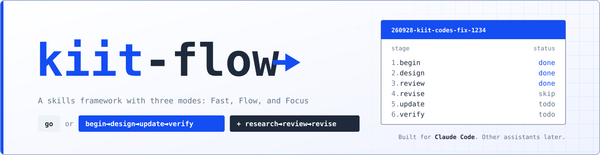
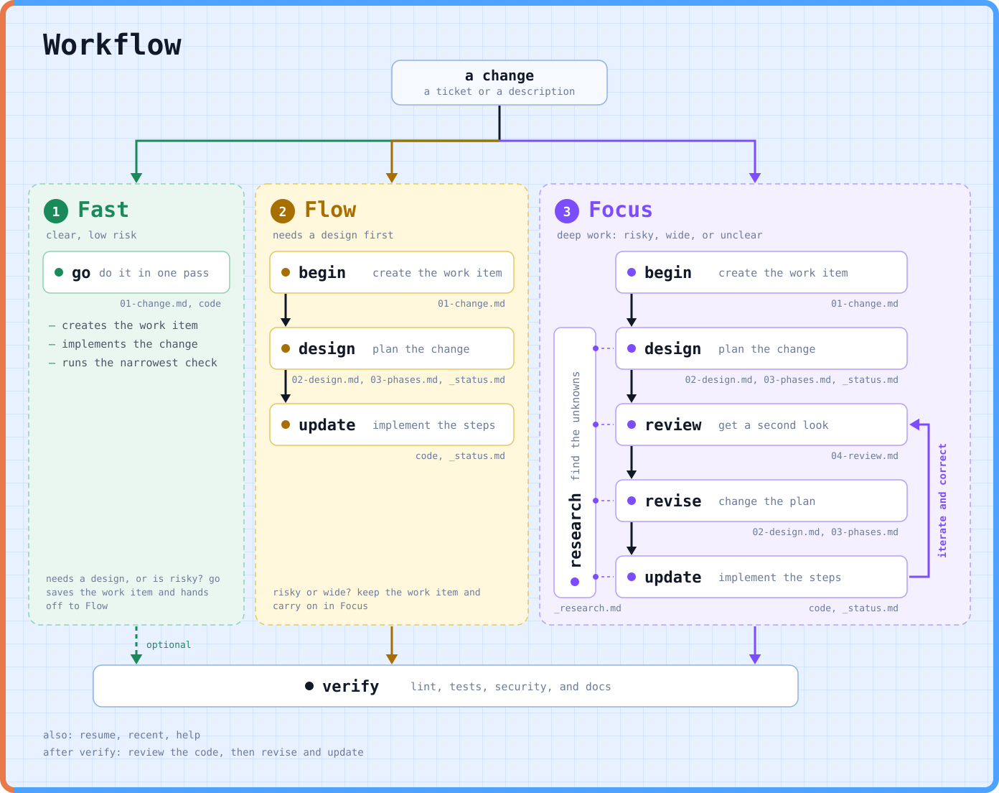

<h1>
  
</h1>

**A skills framework with three modes: Fast, Flow, and Focus**

Skills for Claude Code that take a change from a ticket to a pull request, in one of three ways. **Fast** does a clear, low-risk change in one pass. **Flow** designs first, then implements and verifies. **Focus** is for deep work, risky or unclear changes, with research and a review loop. Every change lives in plain markdown files, so a session can stop and another can pick up from the files, in one repo or across several.

Part of [Kiit](https://www.kiit.dev)

## 📚 Table of Contents

| Section | Description |
|---|---|
| [Why](#why) | What kiit adds: engineering standards, across repos, in skill groups |
| [Standards](#standards) | What ships today, and how a team makes the standards its own |
| [Groups](#groups) | The skill groups and the commands each one has |
| [Start](#start) | Get set up and run a first command |
| [Configuration](#configuration) | The workspace and `kiit.json` |
| [Roadmap](#roadmap) | What is planned next |
| [Requirements](#requirements) | What kiit needs to run |
| [Contributing](#contributing) | How to write or change a skill |
| [License](#license) | Apache 2.0 |

## Why

## Standards

### Defaults

### Overrides

## Groups

### vcs

### flow

### core

## Start

### Install

### Init

### First run

## Configuration

### Tickets

### Projects

## Roadmap

## Requirements

## Contributing

## License

---

**kiit-flow** is one group of skills in [Kiit](https://www.kiit.dev).

