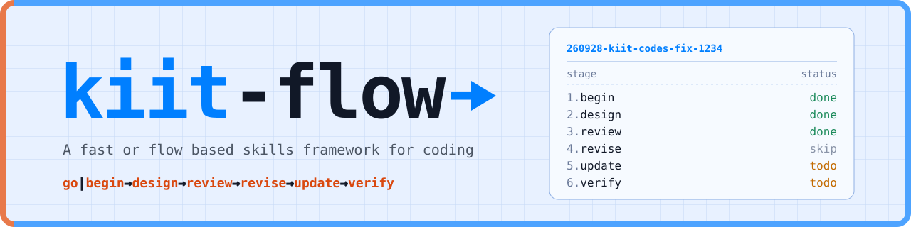
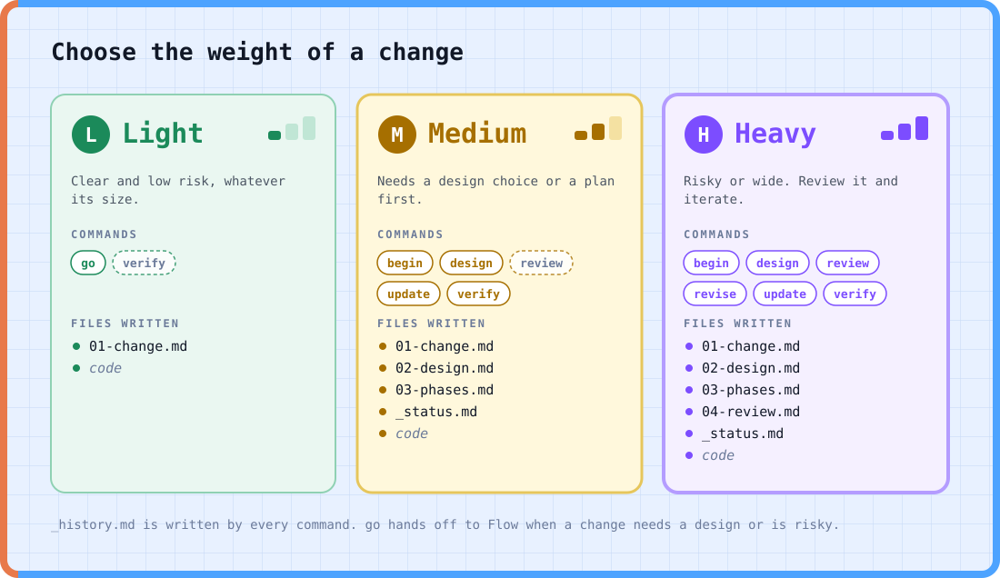
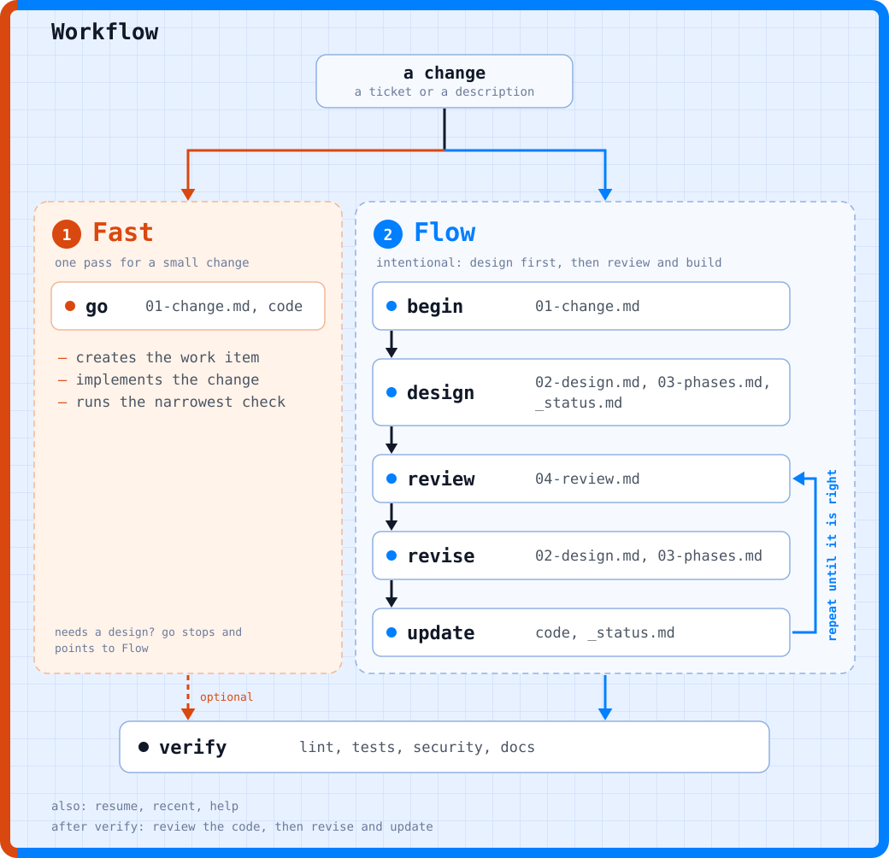
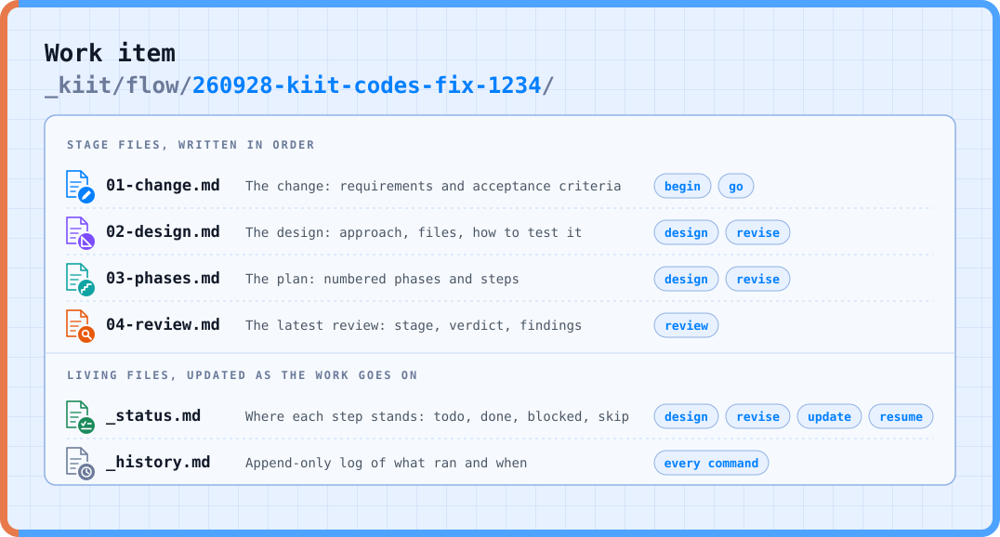

<div align="center">
<h1>
  
</h1>

**A fast, flow, or focus based skills framework for coding with AI**

Skills for AI coding assistants that take a change from a ticket to a pull request, in one of three ways. **Fast** does a clear, low-risk change in one pass. **Flow** designs first, then implements and verifies. **Focus** is for deep work, risky or unclear changes, with research and a review loop. Every change lives in plain markdown files, so a session can stop and another can pick up from the files, in one repo or across several.

[](./LICENSE)

Part of [Kiit](https://www.kiit.dev)

</div>





## 📚 Table of Contents

| # | | Topic | Description |
|---:|:---:|---|---|
| 1 | 💡 | [Why](#why) | The problems flow addresses, and the approach it takes |
| 2 | 🧭 | [Modes](#modes) | Fast, Flow, or Focus: how to choose for a change |
| 3 | 🚀 | [Start](#start) | Install, set up the config, and create a first work item |
| 4 | ⌨️ | [Commands](#commands) | The skills you run, and what is planned |
| 5 | 📁 | [Work Item](#work-item) | The folder of plain markdown files that holds one change |
| 6 | ⚙️ | [Configuration](#configuration) | Ticket systems, projects, and resources in `kiit.json` |
| 7 | 📋 | [Requirements](#requirements) | What flow needs to run |
| 8 | 🤝 | [Contributing](#contributing) | How to write or change a skill |
| 9 | 📄 | [License](#license) | Apache 2.0 license terms |

## Why

Work with an AI coding assistant tends to go wrong in a few repeatable ways:

| # | Problem | Description |
|---:|---|---|
| 1 | **Lost context** | A session ends and the requirements, plan, and progress go with it. |
| 2 | **Unreviewed plans** | Code is written before anyone has read the design. |
| 3 | **Drift** | The design and the code diverge, and nothing records why. |
| 4 | **Unclear done** | There is no checklist to say when the change is finished. |

**kiit-flow keeps each change in a folder of plain markdown files.**

A short set of commands moves the change through its stages: requirements, design, research, review, implementation, and checks. Every command reads what the earlier ones wrote, so a session can stop at any point and another can pick up from the files.

## Modes

Choose by the risk and clarity of the change, not by its size.

| Mode | Use it when | Commands |
|---|---|---|
| **Fast** | The change is clear and low risk, whatever its size. | `go`, then `verify` if you want the full checks |
| **Flow** | The change needs a design before the implementation. | `begin`, `design`, `update`, `verify` |
| **Focus** | Deep work: the change is risky, wide, or unclear. | `begin`, `design`, `review`, `revise`, `update`, `verify`, and `research` when needed |

A change switches mode when it needs to. `go` saves the work item and hands off to `design` if it finds the change needs a design or is risky.

`design` writes the mode to `_status.md`. It is Flow unless you pass `focus`, as in `/kiit-flow-design focus`. Running `research`, `review`, or `revise` on a Flow work item switches it to Focus, so you can start in Flow and move up.

In Focus, `update` and `resume` ask for a review first. `review`, `revise`, and `update` repeat until the work is right. `research` can be used at any step after `begin`, and writes to `_research.md`.

## Start

**Install** into a workspace, the folder that holds your project repos:

```sh
git clone https://github.com/kiitdev/kiit-flow.git
cd kiit-flow
./install.sh /path/to/workspace
```

**Configure** by editing `.claude/kiit/kiit.json` in the workspace. Install creates it from the example, and running install again never overwrites it.

**Run** from the workspace, after restarting your assistant so it loads the skills:

```text
/kiit-flow-help                                           # list the commands
/kiit-flow-begin https://github.com/acme/app/issues/12    # create the work item
/kiit-flow-design                                         # write the design and phases
/kiit-flow-update                                         # implement the phases
/kiit-flow-verify                                         # lint, tests, security, docs
```

That is Flow. `begin` reads the ticket, fills in the project and type, asks you to confirm, and creates the work item.

For a clear, low-risk change, run `/kiit-flow-go` instead (Fast). For risky or unclear work (Focus), add `/kiit-flow-review` and `/kiit-flow-revise` between `design` and `update`.

## Commands

Every command prints its own usage with `--help`, for example `/kiit-flow-begin --help`.

The commands are listed in workflow order. In Focus, `review`, `revise`, and `update` repeat in a loop until the work is right. After `verify`, `review code` checks the finished code.

| # | Command | Description |
|---:|---|---|
| 1 | `/kiit-flow-begin` | Create a work item from a ticket or a description. |
| 2 | `/kiit-flow-go` | Do a clear, low-risk change in one pass, or hand off to `design` if it needs one. |
| 3 | `/kiit-flow-design` | Write the design, phases, and status for a work item. |
| 4 | `/kiit-flow-research` | Look into the unknowns of a work item, and add them to `_research.md`. |
| 5 | `/kiit-flow-review` | Review the plan or the code, and write a verdict. |
| 6 | `/kiit-flow-revise` | Revise the design from your text, a review, or a blocked step. |
| 7 | `/kiit-flow-update` | Implement all phases, a phase, a step, or a range. |
| 8 | `/kiit-flow-resume` | Pick up a work item where it stopped and continue. |
| 9 | `/kiit-flow-verify` | Run the project's own lint, tests, security, and docs checks. |
| 10 | `/kiit-flow-recent` | List work items, newest first, one line each. |
| 11 | `/kiit-flow-help` | Show the commands, or the usage of one. |

## Work Item

A work item is one folder per change. Work items live in `_kiit/flow/` at the workspace root, next to `.claude/` and your project repos:

```text
workspace/
├── .claude/
├── _kiit/flow/
│   └── 260928-kiit-codes-fix-1234/
│       ├── 01-change.md
│       ├── 02-design.md
│       ├── 03-phases.md
│       ├── 04-review.md
│       ├── _status.md
│       ├── _history.md
│       └── _research.md
└── kiit-codes/
```

The folder name is `{YYMMDD}-{project}-{type}-{ticket|short-name}`: the date, the project, the type, and the ticket id, or a short name when there is only a description. Files appear as the commands run, so a new work item has only `01-change.md` and `_history.md`. `go` writes just those two. `_research.md` is written by `research`.



The numbered files are stage artifacts, written in order. The files that start with an underscore change as the work goes on.

The `flow.work_items` setting in `kiit.json` changes the location. The full layout and the file formats are in [`shared/shared.md`](./shared/shared.md).

## Configuration

Flow reads `.claude/kiit/kiit.json` in your workspace. It lists the ticket systems, the projects, and any named resources, and has a section for flow's own settings.

Flow works from a workspace that holds one or more projects. For a single project, list it with a path of `.`.

[`shared/kiit.example.json`](./shared/kiit.example.json) shows the shape. Each key is described in [`shared/shared.md`](./shared/shared.md#workspace-and-config).

## Requirements

- An AI coding assistant that runs skills. Flow is written for Claude Code
- `git`, and a POSIX shell for `install.sh`
- The [GitHub CLI](https://cli.github.com) (`gh`), to read GitHub tickets

## Contributing

Contributions and design feedback are welcome. See [CONVENTIONS.md](./CONVENTIONS.md) for how a skill is written.

## License

[Apache License 2.0](./LICENSE)

---

<div align="center">

**kiit-flow** is one group of skills in [Kiit](https://www.kiit.dev).

</div>
