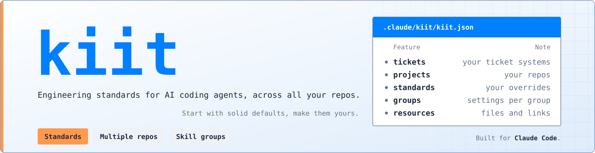
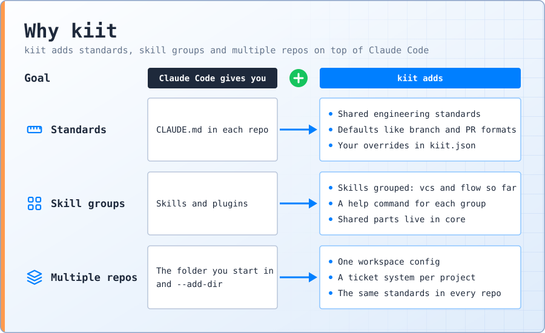
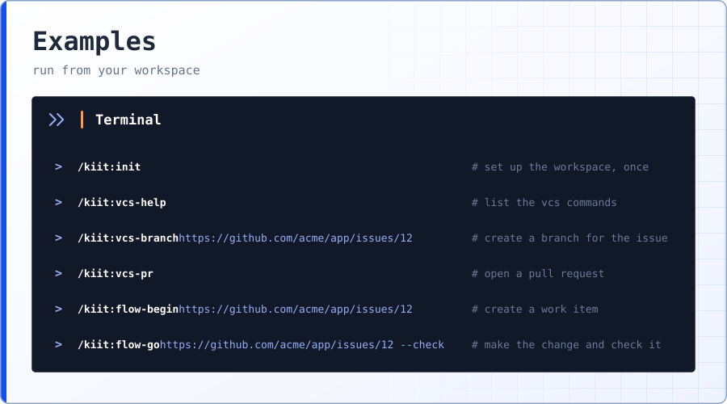
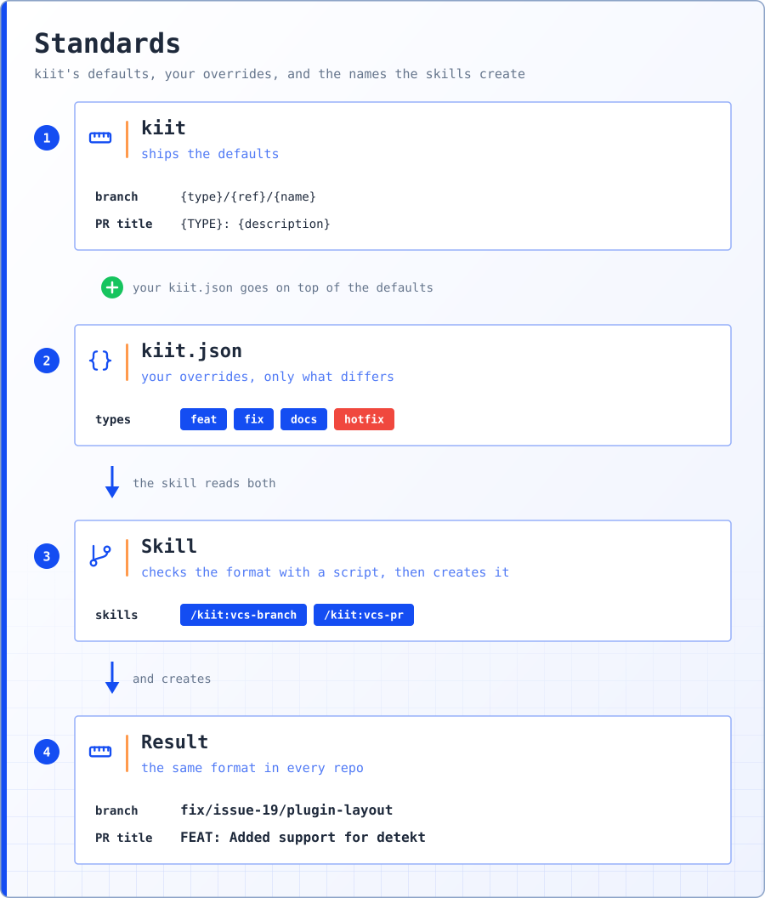
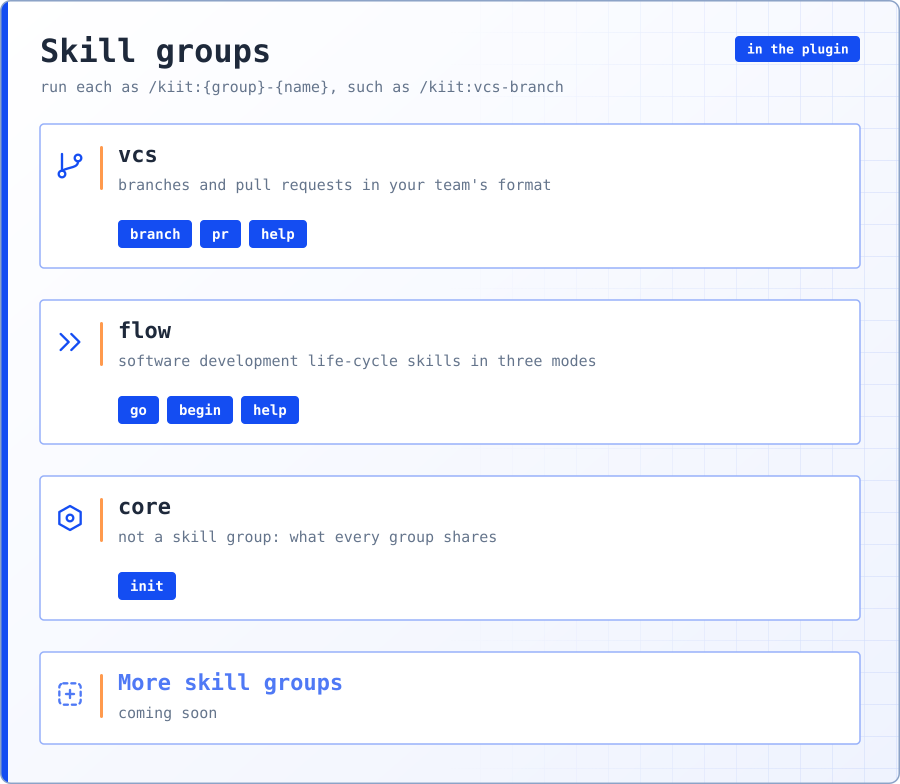
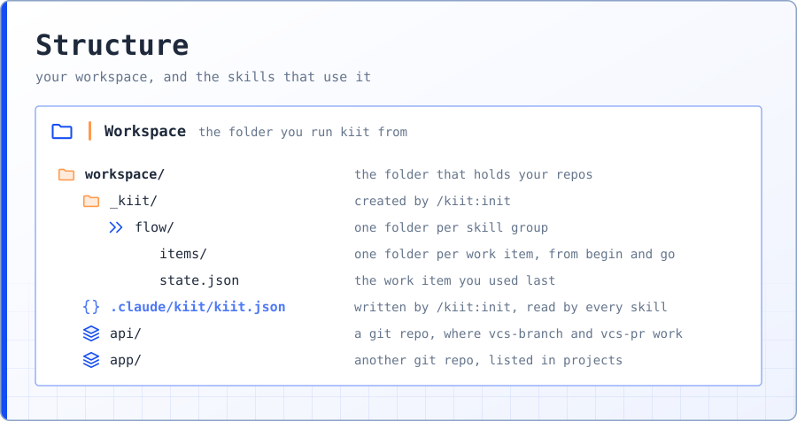

<div align="center">
<h1>
  
</h1>

Kiit is a plugin of skill groups for your coding agent. It keeps your team's engineering standards in one workspace config, such as how branches and pull requests are named, and the skills use them in every repo. The defaults ship with the plugin, you override only what differs, and it all runs as skills inside the agent, so there's nothing to host.

[](./LICENSE)

</div>

## 📚 Table of Contents

| # | | Section | Description |
|---:|:---:|---|---|
| 1 | 💡 | [Why](#why) | What kiit adds: engineering standards, across repos, in skill groups |
| 2 | 🚀 | [Start](#start) | Get set up and run a first command |
| 3 | 📐 | [Standards](#standards) | What ships today, and how a team makes the standards its own |
| 4 | 🧩 | [Groups](#groups) | The skill groups and the commands each one has |
| 5 | ⚙️ | [Configuration](#configuration) | The workspace and `kiit.json` |
| 6 | 🗺️ | [Roadmap](#roadmap) | What is planned next |
| 7 | 📋 | [Requirements](#requirements) | What kiit needs to run |
| 8 | 🤝 | [Contributing](#contributing) | How to write or change a skill |
| 9 | 📄 | [License](#license) | Apache 2.0 |

## Why

Teams with several repos end up with several ways of naming branches, titling pull requests and checking a change. A coding agent follows whatever the repo in front of it does. Kiit gives it one set of standards instead.



| # | | Purpose | Description |
|---:|:---:|---|---|
| 1 | 📐 | **Standards** | Shared defaults, such as branch and pull request formats, with a script that checks them. |
| 2 | 🧩 | **Skill groups** | Skills come in groups, `vcs` and `flow` so far, each with its own commands. |
| 3 | 🗂️ | **Multiple repos** | One workspace config lists your projects, so every repo shares the standards. |

Only `vcs` has standards today. The mechanism is in place for the other groups.

## Start


### Install

```
/plugin marketplace add kiitdev/kiit
/plugin install kiit@kiit-dev
```

### Init

Run it from your workspace, the folder that holds your repos:

```
/kiit:init
```

It reads each repo and configures your `kiit.json` accordingly, and shows what it would write. Nothing is written until you confirm. It also creates the `_kiit/` folder that the groups keep their files in.

Every other command needs this step first, except `--help`.

### First run



```
/kiit:vcs-branch https://github.com/acme/app/issues/12
/kiit:flow-go https://github.com/acme/app/issues/12 --check
```

The first creates a branch for the issue. The second reads the same issue, makes the change, and runs the project's checks and a scan for secrets.

## Standards

A standard is a setting that a group's skills read, such as the format of a branch name. The group ships a default, and your `kiit.json` can override it.



### Defaults

The `vcs` group ships these in its `standards.json`:

| Standard | Default | Example |
|---|---|---|
| Branch name | `{type}/{ref}/{name}` | `fix/issue-19/plugin-layout` |
| Pull request title | `{TYPE}: {description}` | `FEAT: Added support for detekt` |
| Base branch | the repo's default branch | `main` |

The types are `feat`, `fix`, `build`, `chore`, `ci`, `docs`, `perf`, `refactor`, `revert`, `style` and `test`. A branch name has at most five words, and a title at most 70 characters.

A script checks each branch name and title against the pattern before a skill uses it, so the check doesn't depend on the model remembering the format.

### Overrides

`.claude/kiit/kiit.json` in your workspace holds only what differs from the defaults. This adds a `hotfix` type, and starts branches from `develop` in one project:

```json
{
  "standards": {
    "vcs": { "types": ["feat", "fix", "docs", "hotfix"] }
  },
  "projects": [
    { "name": "api", "path": "./api", "baseBranch": "develop" }
  ]
}
```

1. **Replace, not merge.** A key replaces the default for that key as a whole. The list above replaces all eleven types, so `chore` is no longer valid unless you list it.
2. **Unset keys keep their defaults.**
3. `/kiit:init` writes `tickets` and `projects`. You add overrides by hand.

The full schema is in [shared/README.md](./shared/README.md).

## Groups

Skills are named `/kiit:{group}-{name}`. Each group has a `{group}-help` command that lists its skills.



### vcs

Creates branches and pull requests in your team's format. Neither command pushes.

```
/kiit:vcs-branch https://github.com/kiitdev/kiit/issues/39
```

That creates `docs/issue-39/branding-readme-diagrams-writing-style`. The type comes from the `DOCS:` prefix of the issue title, and the name from the title's key words.

More in [docs/group-vcs.md](./docs/group-vcs.md).

### flow

Takes a change from a ticket to a pull request, in one of three modes. **Fast** does a clear, low risk change in one pass. **Flow** designs first, then implements and verifies. **Focus** adds research and a review loop for risky or unclear work. Each change is kept as plain markdown files in a work item folder outside your repos.

The plugin has `/kiit:flow-begin`, `/kiit:flow-go` (Fast) and `/kiit:flow-help` so far. The rest are still being ported, so Flow and Focus can't run yet.

More in [docs/group-flow.md](./docs/group-flow.md).

### core

Not a skill group. It holds what every group shares, and `/kiit:init`, which finds the git repos in your workspace and writes `.claude/kiit/kiit.json` after you confirm.

More in [docs/group-core.md](./docs/group-core.md).

## Configuration

Kiit reads `.claude/kiit/kiit.json` from your workspace. For a single repo, list it as a project with a path of `.`.




### Tickets

`tickets` lists your ticket systems. A project points to one by name.

```json
"tickets": [
  { "name": "oss", "type": "github", "owner": "acme" },
  { "name": "bill", "type": "jira", "url": "https://acme.atlassian.net/browse", "project": "BILL" }
]
```

The types are `github`, `gitlab`, `jira`, `linear` and `other`.

### Projects

`projects` lists the repos that work is done in.

```json
"projects": [
  { "name": "app", "path": "./app", "aliases": ["web"], "tickets": "oss" },
  { "name": "billing", "path": "./billing", "tickets": "bill", "baseBranch": "develop" }
]
```

An alias can be typed instead of the name. `tickets` can be left out when there is only one ticket system.

Every key is described in [shared/README.md](./shared/README.md), and [shared/kiit.example.json](./shared/kiit.example.json) shows the whole file.

## Roadmap

Planned, in no set order. None of it is in the plugin yet.

1. **Remaining flow commands.** Design, research, review, revise, update, resume, verify and recent.
2. **Docs.** A `metadata.json` holds a project's facts, and a standard README is generated from it.
3. **Diagrams.** Architecture kept as structured metadata, with diagrams generated from it.
4. **Recipes.** Grouped recipes for specific tasks that apply your standards and patterns to generate code.
5. **Your own standards.** For databases, API design and more, applied to every project or to one.
6. **Patterns and templates.** Established design patterns, and downloadable templates for apps, APIs and jobs.
7. **Extensions.** A way for people to add their own skills. The details are still open.

## Requirements

1. An AI coding assistant that runs skills. Kiit is written for Claude Code.
2. `git`.
3. The [GitHub CLI](https://cli.github.com) (`gh`), to read GitHub tickets and open pull requests.
4. `glab`, optional, to read GitLab tickets.

## Contributing

Contributions and design feedback are welcome. The skill standards are in [SKILL-STANDARDS.md](./SKILL-STANDARDS.md) and the settled rules are in [RULES.md](./RULES.md). Both are still changing, so open an issue before a large change.

## License

[Apache License 2.0](./LICENSE)

---

<div align="center">

[Kiit](https://www.kiit.dev): engineering standards and skills for AI coding agents. Across multiple repos, start with solid defaults, make them yours.

</div>
