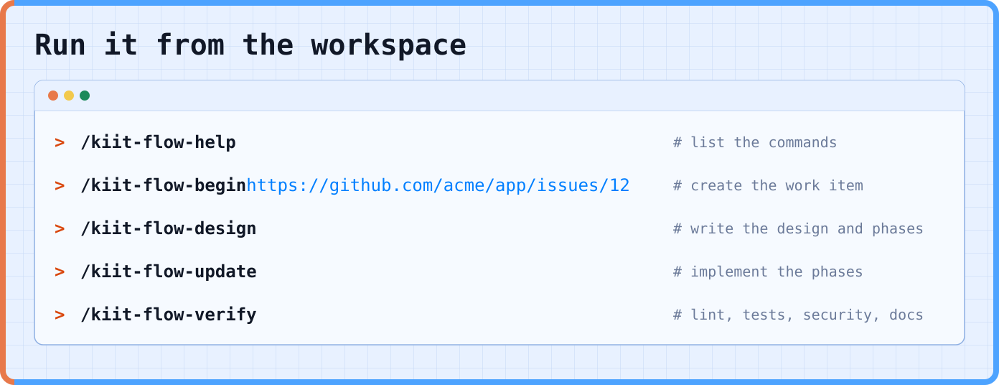
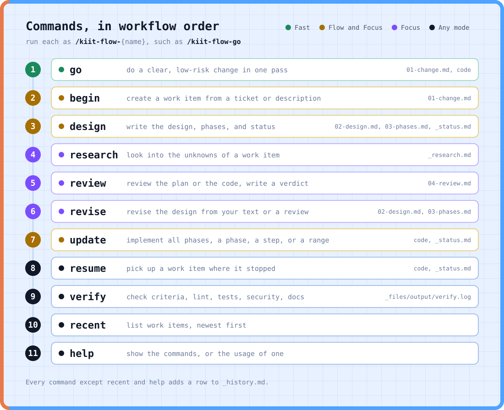

<div align="center">
<h1>
  
</h1>

**A fast, flow, or focus based skills framework for coding with AI**

Skills for AI coding assistants that take a change from a ticket to a pull request, in one of three ways. **Fast** does a clear, low-risk change in one pass. **Flow** designs first, then implements and verifies. **Focus** is for deep work, risky or unclear changes, with research and a review loop. Every change lives in plain markdown files, so a session can stop and another can pick up from the files, in one repo or across several.

[](./LICENSE)

Part of [Kiit](https://www.kiit.dev)

</div>


## 📚 Table of Contents

| # | | Topic | Description |
|---:|:---:|---|---|
| 1 | 💡 | [Why](#why) | The problems flow addresses, and the approach it takes |
| 2 | 🧭 | [Modes](#modes) | Fast, Flow, or Focus: how to choose for a change |
| 3 | 🚀 | [Start](#start) | Install, set up the config, and create a first work item |
| 4 | ⌨️ | [Commands](#commands) | The skills you run, and what is planned |
| 5 | 📁 | [Work Item](#work-item) | The folder of plain markdown files that holds one change |
| 6 | ⚙️ | [Configuration](#configuration) | Ticket systems, projects, and resources in `kiit.json` |
| 7 | 📋 | [Requirements](#requirements) | What flow needs to run |
| 8 | 🤝 | [Contributing](#contributing) | How to write or change a skill |
| 9 | 📄 | [License](#license) | Apache 2.0 license terms |

## Why

Work with an AI coding assistant tends to go wrong in a few repeatable ways. Here is each one, and what flow does about it:

| # | Problem | What goes wrong | How flow handles it |
|---:|---|---|---|
| 1 | **Lost context** | A session ends and the requirements, plan, and progress go with it. | The change lives in markdown files. A new session runs `/kiit-flow-resume` and continues from them. |
| 2 | **Unreviewed plans** | Code is written before anyone has read the design. | `design` writes the plan first. In Focus, `update` asks for a review of the plan before it writes code. |
| 3 | **Changes** | The design and the code diverge, and nothing records why. | `update` stops at a step the code can't support and marks it `blocked`. It never works around it. Every run adds a row to `_history.md`. |
| 4 | **Unclear done** | There is no checklist to say when the change is finished. | `01-change.md` holds the acceptance criteria. Each step has a check, and `verify` runs the project's own lint, tests, security, and docs checks. |
| 5 | **Self review** | The model that wrote the code reviews it, and shares its blind spots. | `review independent` reads the work cold, on another model. |
| 6 | **One size of process** | A typo gets the same ceremony as a migration, or a risky change gets none. | Three modes. Fast does a clear change in one pass, Flow adds a design, and Focus adds research and review. Risk moves a change up a level. |
| 7 | **Stale docs** | A spec kept beside the code becomes a second copy, and copies drift. | No living spec. The code is the source of truth, and the work item records intent. |
| 8 | **Retyping tickets** | Requirements get copied by hand into the session and lose detail on the way. | `begin` reads the ticket and writes `01-change.md`, linking the ticket instead of copying it. |

**kiit-flow keeps each change in a folder of plain markdown files.**

A short set of commands moves the change through its stages: requirements, design, research, review, implementation, and checks. Every command reads what the earlier ones wrote, so a session can stop at any point and another can pick up from the files.

### The approach

1. **Code is the source of truth.** The code defines behavior, so flow keeps no living spec. If you want a spec, derive it from the code. Git holds the code history. The work item holds the rest:

   | Source | Of what |
   |---|---|
   | The ticket | Intent: what was asked |
   | The code | Behavior: what the system does |
   | The work item | The path between them: what was decided, planned, and done |

   When the design and the code disagree, the code wins. `update` stops and asks.

2. **One change, one folder.** A change usually maps to one session and one ticket, so each gets one folder, named with the ticket id. A change can outlast its session, because a new session picks it up with `resume`. A ticket that touches several repos stays in the tracker. A work item starts in the repo where the work begins.

3. **Three modes, because work comes in sizes.** Small, medium, and large changes are different jobs, and coding is no exception. Scope, effort, and time pick the level. Risk is a separate axis that moves a change up a level, so a one line change to auth does not run as Fast.

4. **Review by a different model, when you ask for it.** A model reviewing its own code tends to agree with itself. `independent` hands the work to another model with no session context, only the files and a fixed brief. It is opt in, in every mode.

5. **Claude Code for now.** The skills use Claude Code features directly. Other assistants can come once it works well here.

## Modes

Pick the mode by the scope, effort, and time the change needs. Risk or unclear requirements move it up a level.


1. `go` hands off to `design` when it finds the change needs a design or is risky.
2. `design` writes the mode to `_status.md`. It is Flow unless you run `/kiit-flow-design focus`.
3. `research`, `review`, and `revise` switch a Flow work item to Focus, so you can start in Flow and move up.
4. In Focus, `update` and `resume` ask for a review first.

## Start

**Install** into a workspace, the folder that holds your project repos:

```sh
git clone https://github.com/kiitdev/kiit-flow.git
cd kiit-flow
./install.sh /path/to/workspace
```

**Configure** by editing `.claude/kiit/kiit.json` in the workspace. Install creates it from the example, and running install again never overwrites it.

**Run** from the workspace, after restarting your assistant so it loads the skills:



That is Flow. `begin` reads the ticket, fills in the project and type, asks you to confirm, and creates the work item.

For a clear, low-risk change, run `/kiit-flow-go` instead (Fast). For risky or unclear work (Focus), add `/kiit-flow-review` and `/kiit-flow-revise` between `design` and `update`.

## Commands

Every command prints its own usage with `--help`, for example `/kiit-flow-begin --help`.

The commands are listed in workflow order. In Focus, `review`, `revise`, and `update` form a loop that iterates and corrects until the work is right. After `verify`, `review code` checks the finished code.



## Work Item

A work item is one folder per change. Work items live in `_kiit/flow/` at the workspace root, next to `.claude/` and your project repos.


The folder name is `{YYMMDD}-{project}-{type}-{ticket|short-name}`: the date, the project, the type, and the ticket id, or a short name when there is only a description. Files appear as the commands run, so a new work item has only `01-change.md` and `_history.md`. `go` writes just those two. `_research.md` is written by `research`.

The numbered files are stage artifacts, written in order. The files that start with an underscore change as the work goes on.

The `flow.work_items` setting in `kiit.json` changes the location. The full layout and the file formats are in [`shared/shared.md`](./shared/shared.md).

## Configuration

Flow reads `.claude/kiit/kiit.json` in your workspace. It lists the ticket systems, the projects, and any named resources, and has a section for flow's own settings.

Flow works from a workspace that holds one or more projects. For a single project, list it with a path of `.`.

[`shared/kiit.example.json`](./shared/kiit.example.json) shows the shape. Each key is described in [`shared/shared.md`](./shared/shared.md#workspace-and-config).

## Requirements

- An AI coding assistant that runs skills. Flow is written for Claude Code
- `git`, and a POSIX shell for `install.sh`
- The [GitHub CLI](https://cli.github.com) (`gh`), to read GitHub tickets

## Contributing

Contributions and design feedback are welcome. See [CONVENTIONS.md](./CONVENTIONS.md) for how a skill is written.

## License

[Apache License 2.0](./LICENSE)

---

<div align="center">

**kiit-flow** is one group of skills in [Kiit](https://www.kiit.dev).

</div>
